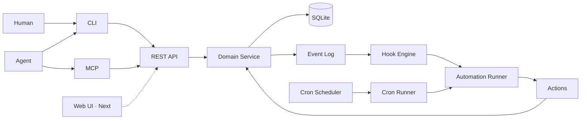
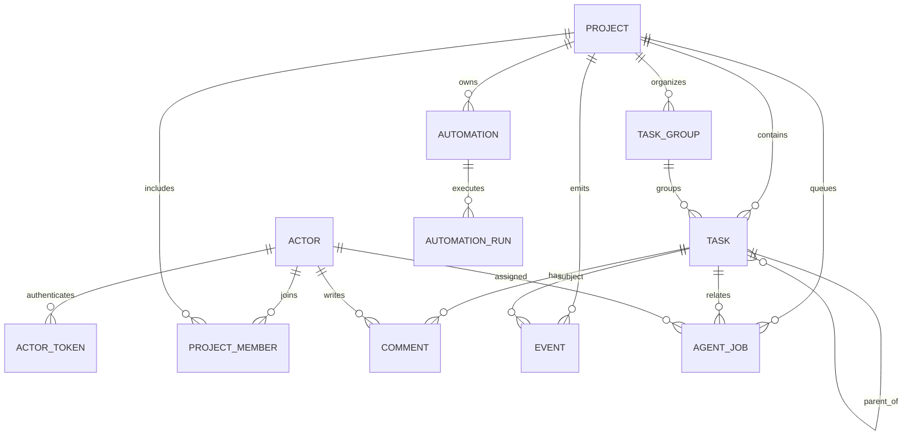
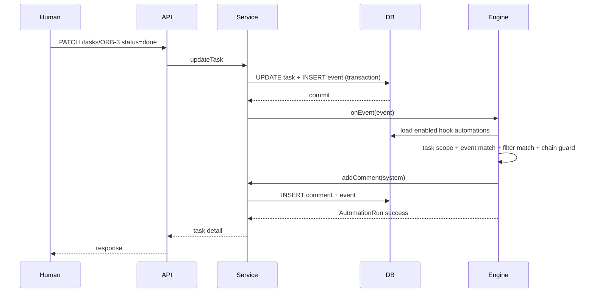

# Orbit — AI 原生项目管理平台设计稿

> 版本：0.1（后端 / CLI / MCP demo）
> 状态：已实现并通过集成测试
> 范围：技术选型、数据库、后端、自动化、MCP、CLI；Web UI 暂不包含

## 1. 一页结论

Orbit 不是“给 Teambition 增加 AI 按钮”，而是把 Agent 作为正式项目参与者：

- 人和 Agent 使用同一套 Actor、Task、Comment、Event、Automation。
- Agent 通过 MCP 领取 Job、读写任务；人类通过 Web UI 或 CLI 做同样的事。
- 所有写入进入 append-only Event Log，形成可审计、可触发的项目事实流。
- cron 与 hook 是同一个 Automation 模块的两类触发器，不是两套系统。
- 所有 Agent 能力收敛到 28 个语义稳定的 MCP 工具。
- 结构保持轻量：`Project → TaskGroup → Task (→ 嵌套 Subtask)`，任务组只做横向分组，没有阶段门状态、Sprint 和自定义字段。

## 2. 目标与非目标

### 2.1 目标

1. 验证“Agent 是项目成员”的产品形态，而不是聊天机器人侧栏。
2. 验证 cron、事件 hook、任务、Agent Job 之间的闭环。
3. 提供人机共用的极简 MCP 与 CLI 契约。
4. 用最少的基础设施跑起完整演示，便于后续迭代。

### 2.2 V1 非目标

- 组织、Workspace、多租户；
- 阶段门自动流转、按阶段审批；
- 自定义字段、文档、邮件/IM 通知（仅实现跨项目汇总的 @提及收件箱）；
- 附件 inline 预览、公开分享链接、断点续传、对象存储与病毒扫描；
- 完整登录、SSO、细粒度 RBAC；
- 后端内置 LLM 调用；
- 外部 Webhook 编排；
- 多人同时编辑同一字段的冲突合并（仅使用版本号保护）。

## 3. 用户与核心循环

### 3.1 人类

```text
查看项目/看板
  → 创建、编辑、评论任务
  → 查看事件流和自动化运行结果
  → 查看 Agent Job 状态
```

### 3.2 Agent

```text
list_jobs(agent="me")
  → claim_job
  → get_project / list_tasks / get_task
  → create_task / update_task / comment_on_task
  → complete_job
```

Agent 不需要“特殊 AI API”。它和人类使用同一套 REST 能力，MCP 只是更适合模型调用的工具封装。

## 4. 总体架构



关键决策：

- **REST 是唯一事实源**：CLI 与 MCP 不直接访问数据库。
- **Automation 共享执行器**：cron 和 hook 只负责产生触发上下文，动作、日志、递归保护共用。
- **Agent Job 是收件箱**：自动化不直接调用模型，而是入队；任何 Agent 运行时都可以通过 MCP 拉取。
- **同步执行**：demo 中自动化动作在请求/调度 tick 内同步完成，便于观察；生产化后应改为外部队列。

## 5. 数据模型

### 5.1 ER 图



### 5.2 表说明

| 表 | 作用 | 关键字段 |
|---|---|---|
| `actors` | 人类、Agent、系统身份 | `kind`, `name` |
| `actor_tokens` | 高熵 token，仅存 SHA-256 | `token_hash`, `token_hint` |
| `projects` | 项目 | `key`（全局唯一，2–20 字符，可带 `-` 尾标，如 `MOUSE-REQ`）, `status` |
| `project_members` | 成员关系 | `role=owner/member`, `role_tag`（项目内职责标签，可空） |
| `task_groups` | 项目内任务组（看板左侧分组、阶段） | `name`（项目内唯一）, `position` |
| `tasks` | 任务与嵌套子任务 | `number`, `parent_task_id`, `group_id`, `status`, `priority`, `kind=task/milestone`, `start_at`, `due_at`, `completed_at`, `version` |
| `comments` | 任务评论 | `task_id`, `author_id` |
| `events` | append-only 事件流 | `type`, `payload`, `task_id` |
| `notifications` | 项目内 @提及通知 | `actor_id`, `comment_id`, `event_id`, `read_at` |
| `automations` | cron/hook 自动化 | `task_id`（NULL=全局）, `trigger_type`, `trigger_config`, `action_type`, `action_config` |
| `automation_runs` | 每次自动化运行 | `status`, `result`, `error` |
| `agent_jobs` | Agent 收件箱 | `status`, `agent_id`, `claimed_by`, `result` |

### 5.3 数据库约束

- SQLite `foreign_keys=ON`，写入使用事务。
- `tasks(project_id, number)` 唯一，结合项目代号形成 `ORB-12` 或子项目 `MOUSE-REQ-1` 引用。
- `task_groups(project_id, name)` 唯一；删除任务组时 `tasks.group_id` 置空，不删除任务。
- `projects.key` 大小写不敏感唯一；格式为 2–20 个字母/数字，首字符为字母，可用 `-` 分隔尾标且每段以字母开头，例如 `MOUSE-REQ`。
- `actor_tokens.token_hash` 唯一；明文 token 只在生成时出现一次。
- `events` 只插入，不更新、不删除。
- `automations.enabled` 与 `next_run_at` 建索引，支持调度扫描。
- `agent_jobs` 按项目/状态和 Agent/状态建索引。

### 5.4 为什么复用 Task 表存子任务

子任务使用同一张 `tasks` 表，通过 `parent_task_id` 表达层级：

- 复用状态、负责人、评论、事件、自动化；
- 看板过滤 `parent_task_id IS NULL`；
- 子任务有独立 ref，Agent 可直接引用；
- 子任务可继续嵌套，任务详情只返回直接子任务，进度按直接子任务计算。

### 5.5 任务组

任务组是项目内的横向分类，与父子层级正交：

- 一个任务最多属于一个任务组，也可以不属于任何组；
- 子任务默认继承父任务的任务组，显式指定不同组会被拒绝（`400`）；
- 顶层任务移动任务组时，其所有层级子任务同步移动；
- 组进度只统计顶层任务（`parent_task_id IS NULL`），与父任务进度口径一致；
- 项目有任务组时，看板返回 `groups` 并渲染分组看板：任务组在左侧从上到下排列，显示数量、进度和说明，右侧是四列状态；没有任务组时保持经典四列看板；
- 看板提供「分组 / 单组」视图切换；单组视图在左侧选择任务组，右侧四列只展示该组任务，当前视图和选中组保存在浏览器本地；
- 任务列表接口在任务对象中返回 `fileCount`（`task_files` 计数子查询）；看板任务卡在 `fileCount > 0` 时于右上角显示 📎 角标，看板顶部「📎 含附件」筛选只保留带附件的任务，分组与单组视图共用同一过滤结果，筛选无匹配时显示空状态与清除按钮；筛选状态不做持久化，切换项目时重置；
- 任务列表支持 `?group=<名称|id>`，`none` / `ungrouped` 表示未分组；
- 看板任务组标题旁提供「编辑」与「删除」；编辑弹窗可修改名称和说明，说明按 Markdown 渲染并支持 `@提及` 与内部引用；删除前弹出确认，组内任务通过外键 `ON DELETE SET NULL` 自动移入未分组，不会被删除。

任务组不是阶段门：没有自动流转、准入条件和审批动作。IPD 项目用它表达六个阶段，但阶段规则仍由任务与自动化表达。

## 6. 任务与子任务语义

### 6.1 状态

固定四种状态：

```text
todo → doing → review → done
```

V1 不限制任意状态间迁移，但有三个硬约束：

1. 父任务进入 `done` 前，全部直接子任务必须为 `done`；
2. 已完成父任务不能再添加子任务；
3. 前置依赖未满足时，按依赖类型阻塞状态前进（见 6.2）。

当全部直接子任务完成时，系统会自动将父任务置为 `done` 并评论「子任务已经全部完成」；若父任务也有父任务，则继续向上递归检查。进度通过每层的 `done/total` 独立展示。

### 6.2 依赖软阻塞

状态前进时（`todo → doing → review → done`，按状态序号比较），服务端检查全部前置依赖；不满足则返回 `409 dependency_blocked`，不会修改任务：

| 类型 | 阻塞开始（doing/review） | 阻塞完成（done） |
| --- | --- | --- |
| `finish_to_start` | 前置必须 `done` | 前置必须 `done` |
| `start_to_start` | 前置必须已开始（非 `todo`） | 前置必须已开始 |
| `finish_to_finish` | 不阻塞 | 前置必须 `done` |
| `start_to_finish` | 不阻塞 | 前置必须已开始 |

`details.unmet` 返回未满足项（`dependencyId`、`type`、`requirement`、`task { id, ref, title, status }`）。回退状态（如 `done → doing`）不检查依赖，方便重新打开任务；编辑标题、说明、负责人等其他字段不受影响。任务抽屉会在前置列表标记「未完成/未开始」，并给被阻塞的状态按钮加红色提示；子任务全部完成但父任务被依赖阻塞时，自动完成会跳过父任务。

### 6.3 父任务完成检查

```text
PATCH /tasks/ORB-2 { "status": "done" }
  → 查询 parent_task_id = ORB-2 且 status != done 的直接子任务
  → 数量 > 0：409 subtasks_incomplete
  → 数量 = 0：允许完成
```

### 6.4 乐观并发

任务写入支持可选 `version`：

- 客户端读取 `version=3`；
- 更新时传 `version=3`；
- 数据库当前版本已变为 4，则返回 `409 version_conflict`。

这为多个 Agent 并发修改同一任务提供最小保护。

### 6.5 时间字段

- `start_at`（开始时间）在创建任务时默认为 `created_at`，也可以显式传入；`due_at`（截止时间）可选，两者都存储 ISO 8601 UTC 字符串；
- 创建与更新接口同时接受 `startAt` / `dueAt`；`dueAt: null` 表示清空截止时间，`startAt` 不允许清空；
- 非法日期返回 `400`；更新不传时间字段时保持原值；
- 任务抽屉用 `datetime-local` 控件编辑开始与截止时间，并按浏览器本地时区展示；创建与完成时间只读；
- 旧数据库升级到 schema v9 时自动添加 `start_at` 列并用 `created_at` 回填。

### 6.6 任务/项目/任务组说明、评论与内部引用

任务说明（`tasks.description`）在抽屉内可直接编辑，保存走 `PATCH /api/v1/tasks/:ref` 并带 `version` 做乐观并发控制。项目名称（`projects.name`）、代号（`projects.key`）和说明（`projects.description`）可在看板顶部的「编辑项目」弹窗中编辑，保存走 `PATCH /api/v1/projects/:ref`，任何项目成员都可修改。任务组名称与说明（`task_groups.description`）通过看板上的「编辑任务组」弹窗修改，保存走 `PATCH /api/v1/groups/:id`。代号变更后任务 ref 和 URL 会跟随新代号，旧代号立即失效；数据库只存项目 id 关联，不存冗余 ref。

评论、项目说明、任务说明和任务组说明共用同一套富文本渲染管线（`public/citations.js` 的 `renderRichText`）：Markdown 渲染后统一解析 `@提及` 与三类内部引用，并支持 WeKnora `<kb />` 引用（解析到知识库时生成外链）。`@姓名` 只在匹配当前项目成员时高亮，内部引用为：

- 任务：`ORB-12`（子任务同样使用独立 ref，如 `ORB-7`；带尾标的子项目任务形如 `MOUSE-REQ-1`）→ 打开对应任务抽屉；
- 项目：`#ORB` 或 `#MOUSE-REQ` → 打开对应项目看板；
- 任务组：`#[概念阶段]` → 打开当前项目并定位到该组（单组视图）。

引用只在能匹配到当前用户可见的项目/任务组时生成链接，未命中的文本保持原样；原始 HTML 不渲染，避免 XSS。引用标记的属性不会被二次解析。

## 7. 事件流

### 7.1 事件类型

| 事件 | 触发时机 | payload 关键字段 |
|---|---|---|
| `project.created` | 创建项目 | `key`, `name` |
| `project.updated` | 项目名称/代号/说明更新 | `key`, `previousKey`, `name`, `fields` |
| `group.created/updated/deleted` | 任务组管理 | `groupId`, `name`, `fields` |
| `task.created` | 创建任务/子任务 | `status`, `priority`, `kind`, `assigneeId`, `startAt`, `dueAt`, `parentId`, `groupId` |
| `task.updated` | 非状态/负责人字段变化 | `fields`, `parentId`, `groupId` |
| `task.status_changed` | 状态变化 | `from`, `to`, `parentId`, `groupId` |
| `task.assigned` | 负责人变化 | `from`, `to`, `parentId`, `groupId` |
| `comment.created` | 新增评论 | `commentId`, `excerpt`, `parentId`, `mentions` |
| `job.created` | 创建 Agent Job | `jobId`, `agentId`, `title` |
| `automation.created/updated` | 自动化管理 | `automationId` |

事件写入与业务写入在同一事务内。事务提交后才派发 hook，避免自动化失败回滚用户操作。

### 7.2 为什么事件流重要

- Hook 的条件过滤依赖事件 payload；
- 人和 Agent 都能通过 `list_activity` 观察“发生了什么”；
- 自动化运行和业务变化可以对齐审计；
- 未来可外接 Kafka、Webhook、审计仓库，而不必改动领域模型。

### 7.3 实时推送、@提及与未读

- `GET /api/v1/events/stream` 以 SSE 推送当前 Actor 可见项目的事件；`GET /api/v1/projects/:ref/events/stream` 保留单项目模式。浏览器使用 fetch `ReadableStream` 携带 Bearer token，避免把 token 放进 URL。
- 连接时通过 `?after=<eventId>` 回放断线期间的事件；客户端以 `event.id` 去重并记录游标。服务端每 15 秒发送心跳，客户端断线后 3 秒重连。
- 事件在事务内写入，广播延迟到微任务并校验事件仍存在，回滚事件不会推送给客户端。广播只发生在单进程内，多实例需要共享总线。
- 评论写入时按项目成员匹配 `@成员名`（不区分大小写、按最长名称优先、同一评论同一成员只通知一次），排除作者本人，写入 `notifications`。
- 通知按 Actor 读取与标记已读；Web UI 顶栏汇总所有项目的未读数，面板支持单条跨项目直达任务与“全部已读”。
- @提及支持浏览器桌面通知：面板内由用户手势触发 `Notification.requestPermission()`，授权后全局 SSE 的 `comment.created` 事件会按 `payload.mentions` 判断当前 Actor 并弹出系统通知，点击回到对应任务。
- 评论框使用带搜索的成员选择器；选中后插入 `@成员名`，输入区与已发布评论中的有效提及均以红色高亮，匹配规则与服务端一致。
- 人类评论提及 Agent 时，评论提交后创建 `context.kind = mention_reply` 的 Agent Job。Prompt 只保留触发评论、项目说明、任务组说明、当前任务、父任务、子任务、相关任务和最近 3 条讨论；项目统计、同级任务、依赖和附件清单不进入 Prompt。各段按名称/说明分别裁剪，单段最长 800 字，子任务最多 8 条、相关任务最多 5 条，整体控制在约 4,000 字符，超预算时从低优先级段落开始截断。Agent 的回复以评论形式写回并触发原有 SSE 刷新。Agent 或系统作者的提及不会创建回复 Job，避免循环。
- 在线状态由服务端内存中的 SSE 连接计数维护；`GET /api/v1/presence?project=<ref>` 仅返回请求者可见项目内的在线成员，连接关闭即释放。Web UI 每 15 秒轮询一次，并在实时流就绪时立即刷新。
- 动态页提供最近 24 小时的客户端摘要（任务变更、评论、自动化/Agent 动态与活跃成员），不额外调用 LLM。

### 7.4 跨项目个人任务

- `GET /api/v1/me/tasks` 以当前 Actor 为中心跨项目聚合任务；`scope` 取 `related`（默认，指派给我或我创建）、`assigned`、`created`，并支持 `status`、`kind`、`overdue=true`、`q` 过滤。
- 查询先校验 `project_members` 成员关系，再按 `task_assignees` / `created_by` 匹配，避免泄露未加入项目的任务。
- 返回 `items` 与 `stats`（总数、待办、进行中、待验收、完成、逾期）；统计忽略状态与类型筛选，便于个人页展示全局概览。
- Web UI 的 `/ui/me` 按项目分组渲染，自动按 `offset` 翻页加载全部任务，支持范围、状态（含「逾期」）、类型筛选与标题/描述关键词搜索，逾期高亮、里程碑标识和关系标签；点击任务通过 `?task=<ref>` 在当前页叠加抽屉，不跳转项目页。独立路径 `/ui/tasks/<ref>` 只加载任务及其项目上下文，用于通知、外部链接和直接分享；全局 SSE 事件会触发静默刷新。
- 抽屉内的父任务、子任务和依赖链接会根据当前页面生成目标：项目页继续使用项目内任务路径，个人页使用 `?task=`，独立任务页使用 `/ui/tasks/<ref>`，从而避免任何一次任务跳转强制进入项目页面。

### 7.5 任务附件

- 元数据存 `task_files`（schema v7），内容存本地磁盘 `ORBIT_FILES_DIR`；不使用 SQLite BLOB，避免 WAL 与备份膨胀。
- 上传走 `POST /api/v1/tasks/:ref/files` 的 `multipart/form-data`，单文件、单任务数量与项目配额分别由 `ORBIT_MAX_UPLOAD_MB`、`ORBIT_TASK_FILE_LIMIT`、`ORBIT_PROJECT_QUOTA_MB` 控制。
- 文件以随机 id 命名并分片落盘；显示名只用于界面与下载头。写入顺序为临时文件 → 流式校验/计数/sha256 → 原子 rename → DB 事务插入 → 提交后发事件；DB 失败会删除文件。
- 读、写、删都校验项目成员；删除仅限上传者或项目负责人。下载接口在 `/api/v1` 下，响应固定 `attachment` + `application/octet-stream` + `nosniff`，不做同源 inline 预览。
- Web UI 使用带 Bearer 的 `fetch` 获取 Blob 后触发下载，上传使用 XHR 展示进度；不把 token 放进 URL。
- 事件类型为 `file.uploaded` / `file.deleted`，只包含元数据，不通过 SSE 传输文件内容。
- 删除先提交 DB 事务再删除磁盘对象；崩溃留下的孤儿对象与任务/项目级联删除的物理文件需要后续 GC 处理。

### 7.6 项目角色标签

- 角色标签存放在 `project_members.role_tag`（schema v10，可空，最长 40 字符），与全局 `actors.title` 职位字段分离：职位描述“这个人是谁”，标签描述“这个人在这个项目里负责什么”，类似 IPD 的角色分工。
- 一个成员在每个项目最多一个标签，但可以在不同项目拥有不同标签；同一项目内的多角色拆分不在当前范围内。
- `GET /api/v1/projects/:ref/members` 与项目详情返回 `roleTag`；看板负责人、提及选择器和成员卡片会展示该标签。
- `PATCH /api/v1/projects/:ref/members/:actor` 更新标签。项目负责人可以修改任意成员，普通成员只能修改自己；清空时传 `null`。
- `GET /api/v1/actors/:ref/memberships` 只返回请求者与目标 Actor 的共同项目及各自标签，用于“编辑人员”弹窗，避免泄露未共同参与的项目。弹窗内通过项目下拉框切换，一次只编辑当前选中项目的标签，切换时保留未保存的草稿。
- 标签变更写入 `member.updated` 事件，动态流显示为“成员角色更新”。

## 8. Automation

### 8.1 统一模型

```text
Automation
├─ scope
│  ├─ global（task_id = NULL，项目内所有任务）
│  └─ task（task_id 指向单个任务）
├─ trigger
│  ├─ cron { expression, timezone }
│  └─ hook { event, filter }
├─ action
│  ├─ create_task { title, description?, status?, priority?, kind?, assignee? }
│  ├─ add_comment { body }
│  └─ enqueue_agent { agent, prompt, title? }
├─ enabled
├─ next_run_at
└─ runs[]
```

cron 和 hook **不是两个模块**。它们是两个 trigger adapter，最终都进入同一个 `AutomationEngine.runOnce()`。
指定任务规则在 hook 分发时按 `task_id` 过滤，在 cron / 手动运行时把该任务注入模板、评论和 Job 上下文。

### 8.2 Hook 执行



过滤是浅层 exact match：

```json
{ "event": "task.status_changed", "filter": { "to": "done" } }
```

### 8.3 Cron 执行

- 创建 cron 时用 Croner 计算并持久化 `next_run_at`。
- 进程内 scheduler 每 15 秒扫描一次 `next_run_at <= now` 且启用的自动化。
- 执行前先推进 `next_run_at`，避免同一次触发被重复执行。
- 服务重启后依赖持久化的 `next_run_at`；停机期间错过的多次触发只补执行一次。

### 8.4 动作

| Action | 行为 | 约束 |
|---|---|---|
| `create_task` | 由系统创建任务并继续派发事件 | 标题渲染后不能为空 |
| `add_comment` | 向触发任务或指定任务追加系统评论 | 必须有任务上下文：hook，或指定任务的 cron |
| `enqueue_agent` | 创建 Agent Job，可关联任务 | 目标必须是项目内 Agent 成员 |

### 8.5 模板变量

```text
{{project.key}}   {{project.name}}
{{task.ref}}      {{task.title}}     {{task.status}}
{{actor.name}}    {{event.type}}     {{date}}
```

缺失变量渲染为空字符串。

### 8.6 递归保护

- 每个自动化执行时把 `automationId` 加入 chain。
- 同一 chain 不重复执行同一个自动化。
- chain 最大 4 层，超过后记录错误并停止向下触发。
- 自动化创建任务/评论会产生新事件，因此允许多个自动化按链路协作，但不会无限自触发。

### 8.7 运行日志

每次执行创建 `AutomationRun`：

```json
{
  "status": "success",
  "triggerType": "hook",
  "triggerPayload": { "eventId": 10, "eventType": "task.status_changed" },
  "result": { "type": "comment.created", "taskRef": "ORB-3" },
  "error": null
}
```

失败会记录 `status=failed` 与错误信息，但不会回滚原始业务写入。

## 9. Agent Job

### 9.1 状态

```text
queued → claimed → done
                  ↘ failed
```

- `queued`：等待 Agent 领取；
- `claimed`：必须由领取者完成；
- 预分配给某 Agent 的 Job，只能由该 Agent 领取；
- 未预分配的 Job，项目内成员可领取（便于人类调试 demo）。

### 9.2 Job 内容

```json
{
  "title": "紧急任务分诊：公网入口",
  "prompt": "评估 ORB-9 的影响并给出下一步",
  "taskRef": "ORB-9",
  "agent": "Atlas",
  "context": {
    "automationId": "aut_urgent_triage",
    "eventType": "task.created",
    "triggeredBy": "act_lin"
  }
}
```

### 9.3 完成语义

`complete_job` 只记录结果，不自动评论任务。Agent 应显式调用 `comment_on_task`：

- 结果与任务讨论分离；
- 避免系统自动生成难以归因的评论；
- Agent 可以选择部分结论写入任务。

## 10. REST API

### 10.1 约定

- 前缀：`/api/v1`
- 鉴权：`Authorization: Bearer <token>`
- 成功：`{ "data": ..., "meta": ... }`
- 失败：`{ "error": { "code", "message", "details" } }`
- 引用：项目可用 id 或 key；任务可用 id 或 `ORB-12`
- 写操作返回稳定 ref，便于 Agent 继续操作

### 10.2 端点

| 方法 | 路径 | 说明 |
|---|---|---|
| GET | `/health` | 公共健康检查 |
| GET | `/api/v1/me` | 当前 Actor |
| GET | `/api/v1/me/tasks` | 跨项目个人任务（`scope=related/assigned/created`，可按状态、类型与关键词过滤，`limit/offset` 分页，附 `hasMore` 与统计） |
| GET/POST | `/api/v1/projects` | 项目列表/创建 |
| GET | `/api/v1/projects/:ref` | 项目详情、成员、统计 |
| PATCH | `/api/v1/projects/:ref` | 更新项目名称/代号/说明（成员均可） |
| GET/POST | `/api/v1/projects/:ref/members` | 成员列表 / 加入项目（可带 `roleTag`） |
| PATCH | `/api/v1/projects/:ref/members/:actor` | 更新项目角色标签（负责人可改他人，成员可改自己） |
| DELETE | `/api/v1/projects/:ref/members/:actor` | 移除成员 |
| GET | `/api/v1/actors/:ref/memberships` | 与请求者共同参与的项目及角色标签 |
| GET | `/api/v1/projects/:ref/board` | 顶层任务看板，含任务组分组 |
| GET/POST | `/api/v1/projects/:ref/groups` | 任务组列表/创建 |
| GET/POST | `/api/v1/projects/:ref/tasks` | 任务列表/创建（支持 `group` 过滤） |
| GET | `/api/v1/projects/:ref/activity` | 事件流 |
| GET | `/api/v1/events/stream` | 全局 SSE，推送 Actor 可见项目的事件（`?after=` 回放） |
| GET | `/api/v1/projects/:ref/events/stream` | 单项目 SSE 实时事件推送（`?after=` 回放） |
| GET | `/api/v1/notifications` | 当前 Actor 的跨项目提及收件箱（可按项目/未读过滤） |
| POST | `/api/v1/notifications/read` | 按 id、项目标记已读；空对象表示全部已读 |
| GET | `/api/v1/presence` | 在线成员（可按项目过滤，仅返回可见成员） |
| GET/POST | `/api/v1/projects/:ref/automations` | 自动化列表/创建 |
| GET/POST | `/api/v1/projects/:ref/jobs` | Job 列表/创建 |
| GET/PATCH/DELETE | `/api/v1/groups/:id` | 任务组详情/更新/删除 |
| GET/PATCH | `/api/v1/tasks/:ref` | 任务详情/更新 |
| GET/POST | `/api/v1/tasks/:ref/files` | 附件列表 / multipart 上传（字段 `file`） |
| GET | `/api/v1/files/:id/download` | 鉴权下载，`attachment` 流式响应 |
| DELETE | `/api/v1/tasks/:ref/files/:id` | 删除附件（上传者或项目负责人） |
| POST | `/api/v1/tasks/:ref/comments` | 添加评论 |
| GET/PATCH | `/api/v1/automations/:id` | 自动化详情/更新 |
| POST | `/api/v1/automations/:id/run` | 立即运行 |
| GET | `/api/v1/jobs/:id` | Job 详情 |
| POST | `/api/v1/jobs/:id/claim` | 领取 |
| POST | `/api/v1/jobs/:id/complete` | 完成/失败 |

### 10.3 主要错误码

| HTTP | code | 场景 |
|---|---|---|
| 400 | `validation_error` | Zod 参数校验失败 |
| 401 | `unauthorized` | token 缺失/无效 |
| 403 | `forbidden` | 非项目成员 |
| 404 | `not_found` | 项目/任务/自动化/Job/附件不存在 |
| 413 | `payload_too_large` | 附件超过单文件上限或项目配额 |
| 409 | `subtasks_incomplete` | 子任务未完成时完成父任务 |
| 409 | `parent_done` | 向已完成父任务添加子任务 |
| 409 | `group_name_taken` | 项目内任务组名称重复 |
| 409 | `version_conflict` | 乐观并发冲突 |
| 409 | `job_assigned_elsewhere` | 领取他人预分配 Job |
| 409 | `job_not_claimed` | 未领取就完成 Job |

## 11. MCP 设计

### 11.1 原则

1. **控制在 30 个工具以内**，避免工具爆炸；当前 28 个。
2. 名称使用稳定动词 + 对象：`list_tasks`, `claim_job`。
3. 读工具默认返回结构化 JSON，避免要求 Agent 解析人类表格。
4. 引用使用 `ORB-12`，与人类沟通一致。
5. 工具描述说明前置条件，例如“完成父任务前必须完成子任务”。
6. MCP 通过 REST 调用，不在 MCP 内复制业务规则。
7. 人员与成员管理不暴露给 Agent，避免 Agent 自行扩权。

### 11.2 工具清单

| 工具 | 读/写 | 说明 |
|---|---|---|
| `list_projects` | 读 | 当前 Actor 可见项目 |
| `get_project` | 读 | 成员与统计 |
| `get_board` | 读 | 看板视图（任务组 + 任务） |
| `list_groups` | 读 | 项目任务组与进度 |
| `get_group` | 读 | 单个任务组 |
| `create_group` | 写 | 创建任务组 |
| `update_group` | 写 | 更新任务组，变更级联到嵌套子任务 |
| `delete_group` | 写 | 删除任务组 |
| `list_tasks` | 读 | 顶层任务/子任务过滤（支持 `group`） |
| `get_task` | 读 | 任务、嵌套子任务、评论、依赖、version |
| `create_task` | 写 | 创建任务或嵌套子任务（支持 `group`、`parent`） |
| `update_task` | 写 | 更新字段、状态、负责人、任务组 |
| `add_task_dependency` | 写 | 添加前置/后置依赖 |
| `remove_task_dependency` | 写 | 移除依赖 |
| `request_ai_suggestion` | 写 | 请求 Agent 生成任务 AI 建议评论 |
| `comment_on_task` | 写 | 评论任务 |
| `list_activity` | 读 | 事件流 |
| `list_automations` | 读 | cron/hook 列表 |
| `get_automation` | 读 | 单个自动化 |
| `create_automation` | 写 | 创建统一 Automation |
| `update_automation` | 写 | 更新自动化（名称、开关、触发器、动作） |
| `delete_automation` | 写 | 删除自动化 |
| `run_automation` | 写 | 立即执行 |
| `list_jobs` | 读 | Agent 收件箱 |
| `get_job` | 读 | 单个 Job 详情 |
| `create_job` | 写 | 委派工作给 Agent |
| `claim_job` | 写 | 领取 Job |
| `complete_job` | 写 | 完成/失败 Job |

身份与成员管理（`actors`、`projects/:ref/members`）保留在 UI/REST，不暴露给 Agent。

### 11.3 身份与传输

- stdio transport；
- `ORBIT_API_URL` 指向 REST；
- `ORBIT_TOKEN` 是 Agent token；
- 所有日志写 stderr，stdout 只承载 MCP 协议。

## 12. CLI 设计

### 12.1 双模输出

- 默认：人类表格、状态着色、任务详情、看板；
- `--json`：稳定 JSON，便于 Agent 或脚本消费；
- 命令失败：stderr + 非 0 退出码；API 错误包含 code 与 details。

### 12.2 命令设计

```text
projects / project / board
groups / group / group-create / group-update / group-delete
tasks / task / create / update / comment / activity
automations / automation / automation-create / automation-run
jobs / job / job-create / job-claim / job-complete
me / mcp-config
```

任务和 Job 命令使用名词/动词语义，不隐藏资源类型。所有写命令输出稳定 ref 或 id。

## 13. 技术选型

| 层 | 选择 | 原因 | 替代方案 |
|---|---|---|---|
| 语言 | TypeScript | 前后端/MCP 类型共享，CLI 生态成熟 | Python |
| HTTP | Fastify | 轻量、启动快、插件与校验清晰 | NestJS（对 demo 过重） |
| 数据库 | SQLite | 单文件、零运维、事务/索引足够 demo | PostgreSQL（生产多实例） |
| SQLite driver | Node 内置 `node:sqlite` | 无 native addon，安装简单 | better-sqlite3 |
| 校验 | Zod | 路由、MCP 输入和类型共用 | JSON Schema 手写 |
| Cron | Croner | 时区支持、nextRun 计算、无外部依赖 | node-cron |
| MCP | 官方 TypeScript SDK | 协议兼容性最好 | 手写 JSON-RPC |
| CLI | Commander | 成熟、帮助信息完整 | 手写 parseArgs |
| Agent 执行 | 外部 Agent + MCP | 后端不持有模型 Key；技术栈无关 | 内置 Agent Runner |
| 前端 | 暂不实现 | 先验证后端与 Agent 闭环 | Next.js + React |

### 13.1 为什么不用 PostgreSQL

demo 需要一条命令启动，SQLite + WAL 足够。生产化时：

- SQLite 文件锁限制单写者；
- 多实例 scheduler 会重复触发；
- 需要任务队列、分布式锁、迁移工具；
- 届时建议 PostgreSQL + 外部队列，但领域模型和 API/MCP 契约不需要变。

### 13.2 为什么后端不直接调 LLM

- 模型、供应商、凭据策略会快速变化；
- 外部 Agent 可用任意 MCP 客户端运行；
- Job 队列让 Agent 断线、重试、审计更自然；
- 后端只负责项目事实与工作分派，避免成为不可替换的 Agent runtime。

## 14. 数据库初始化与迁移

```text
openDatabase(path)
  → mkdir
  → PRAGMA foreign_keys=ON, busy_timeout=5000, WAL
  → migrate()
      → 检查 user_version
      → 执行幂等 schema
      → 补齐增量列（automations.task_id、tasks.group_id、project_members.role_tag 等）
      → 写入 system actor
      → 旧库迁移：IPD 阶段前缀任务 → 任务组
      → 设置 user_version=SCHEMA_VERSION（当前 10）
```

- v10 为 `project_members` 增加可空的 `role_tag` 列，旧成员关系保留且默认无标签；
- v3 迁移把 IPD 项目原有的 6 个顶层阶段任务转为 6 个任务组，把阶段下 5 个子任务提升为组内顶层任务；
- 迁移保留原任务 id、number、评论、Job 和事件引用，仅删除原阶段父任务及其事件；
- 标题中的 `【阶段】` 前缀会被移除，任务组成为唯一分类来源；
- 已有任务组时迁移幂等跳过。

- `npm run setup`：初始化并写入 demo 数据。
- `npm run db:reset`：删除数据库与本地 token 配置后重建（需先停服务）。
- token 只在 setup 时生成并写入 `.orbitrc.json`，数据库只存哈希。

## 15. 安全与生产化

### 15.1 demo 现状

- token 是本地固定的高熵 demo token；
- 所有项目成员具有相同写权限；
- 无速率限制、无登录页、无 CSRF；
- MCP 配置包含 token，代码中不会打印到仓库。

### 15.2 生产化必须补

1. 正式身份系统与 token 轮换、撤销；
2. 项目级 RBAC（owner/member/viewer）与自动化审批；
3. 输入内容信任边界，防 prompt injection；
4. API 速率限制、审计导出、敏感字段脱敏；
5. 外部队列 + Job 抢占 + 重试/死信；
6. 多实例 cron 去重；
7. 备份、迁移、可观测性（结构化日志、指标、trace）；
8. 若做 Web：CSRF、CSP、会话安全、文件上传隔离。

## 16. 3 分钟演示脚本

```bash
# 0. 初始化并启动
npm run setup
npm run dev

# 1. 人类观察项目和子任务
npm run orbit -- board ORB
npm run orbit -- task ORB-2

# 2. 人类创建紧急任务，hook 自动派发 Agent Job
npm run orbit -- create ORB "确认公网演示入口" --priority urgent --assignee Lin
npm run orbit -- jobs ORB

# 3. Agent 领取并完成 Job
npm run orbit -- jobs ORB --mine --as agent
npm run orbit -- job-claim <job-id> --as agent
npm run orbit -- job-complete <job-id> "已评估：需要反向代理和访问控制" --as agent

# 4. 完成任务，hook 自动评论留痕
npm run orbit -- update ORB-3 --status done
npm run orbit -- task ORB-3
npm run orbit -- activity ORB --limit 10

# 5. 手动触发一次 cron，验证相同 Action 模型
npm run orbit -- automation-run aut_morning_digest
npm run orbit -- jobs ORB

# 6. 输出 MCP 配置，连接外部 Agent
npm run build
npm run orbit -- mcp-config
```

演示重点：

- cron 与 hook 最终都只产生 Job；
- Agent 不是被后端直接调用，而是通过 MCP 拉取；
- 人的任务操作会自然触发自动化，事件流完整可见；
- 父子任务约束和乐观并发不是靠 UI，而是后端不变量。

## 17. 路线图

### P1 — 已实现

后端、SQLite、REST、CLI、MCP、cron/hook、Agent Job、子任务、集成测试。

### P2 — 可用性

- 极简 Web 看板（项目、看板、任务详情、事件、自动化、Job）；
- 更好的 Agent Job 重试与超时；
- 外部 Webhook 入口/出口；
- 任务活动与 Agent 结果的统一展示。

### P3 — 团队化

- Workspace、项目角色、审批策略；
- PostgreSQL + 外部队列；
- 多 Agent 并发控制；
- 自动化条件 DSL、运行取消、幂等键；
- Agent 记忆/上下文压缩与结果质量评估。

## 18. 决策记录

| 决策 | 结论 | 理由 |
|---|---|---|
| 是否拆 cron/hook 模块 | 不拆 | 共享动作、日志、递归保护，降低人和 Agent 的理解成本 |
| 子任务层级 | 不限层级 | 通过 `parent_task_id` 表达，直接子任务完成时逐层向上级联 |
| 是否自动 rollup 父任务状态 | 是 | 全部直接子任务完成后自动完成父任务，进度仍按层单独展示 |
| Agent 执行位置 | 外部 | 后端不持有模型 Key，支持任意 MCP 客户端 |
| Job 完成是否自动评论 | 否 | 讨论与结果解耦，Agent 显式评论 |
| API 与 MCP 关系 | MCP 调 REST | 单一事实源，不复制业务逻辑 |
| 前端 | 后置 | 先验证 Agent/自动化闭环 |
